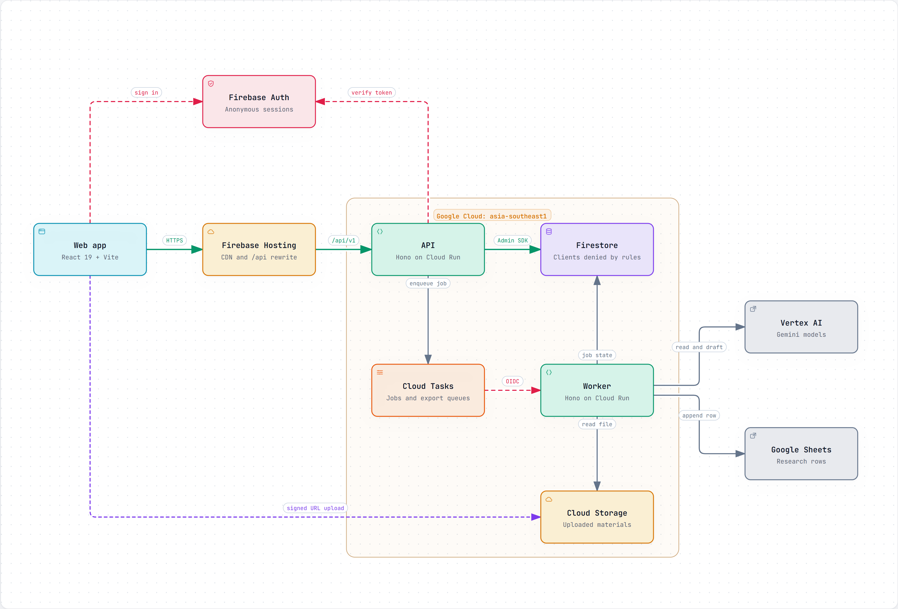

<div align="center">
  

  <h1>LOGINA</h1>

  <p><i>Teacher-governed reasoning tasks, built from a teacher's own material.</i></p>

  <p>
    <a href="https://logina-dev.web.app"></a>
    
    
    
    
    
    
    
    
  </p>

  <p><b>Live Demo:</b> <a href="https://logina-dev.web.app">https://logina-dev.web.app</a></p>

  <p>No sign-in needed: every browser gets its own private workspace.</p>
</div>

---

LOGINA turns a lesson source into a set of five reasoning tasks. AI reads the material and drafts the tasks, the teacher approves the source and the tasks, and students work through each task with one approved prompt to think again. AI never talks to students, and nothing it produces reaches them without a teacher's approval.

## Contents

- [How it works](#how-it-works)
- [Architecture](#architecture)
- [Tech stack](#tech-stack)
- [Repository layout](#repository-layout)
- [Getting started](#getting-started)
- [Commands](#commands)
- [Testing](#testing)
- [Deployment](#deployment)
- [Security and privacy](#security-and-privacy)
- [Research data](#research-data)
- [Acknowledgements](#acknowledgements)
- [License](#license)

## How it works

### For teachers

1. **Upload** a PDF or DOCX, up to 20 MB and 10 pages, or use the sample material.
2. **Review the source.** AI reads the material, and the teacher resolves anything it flags. This ends in Approval 1.
3. **Review the tasks.** AI drafts tasks Q1 to Q5, each with its student prompts, and every evidence quote is checked word for word against the approved source. This ends in Approval 2.
4. **Assign** the set to a class. Assigning distributes the tasks; it approves nothing.
5. **Track** how students answered, with per-student traces and class summaries.

### For students

Each of the five tasks follows the same steps:

1. **Answer on your own.**
2. **Lock in** the answer and record a confidence level.
3. **Think again** with one teacher-approved prompt. It does not say whether the answer is right.
4. **Final answer:** keep or revise it, record confidence again, and submit.

| Task | Name | What the student does |
|---|---|---|
| Q1 | Statement | Chooses a statement and the evidence card that supports it |
| Q2 | Rank cards | Drags the cards into order, strongest first |
| Q3 | Compare | Compares options on each criterion, decides, and names the drawbacks accepted |
| Q4 | Counterargument | Builds an argument from a template |
| Q5 | Proposal | Writes a short proposal and the reason for it |

LOGINA does not grade or rank students, and it makes no claims about learning gains from click data.

## Architecture



Open [`docs/architecture/logina-architecture.html`](docs/architecture/logina-architecture.html) in a browser for the interactive version. The diagram source is [`logina.architecture.json`](docs/architecture/logina.architecture.json), rendered with [Archify](https://github.com/tt-a1i/archify).

- **Request path.** The React app is served by Firebase Hosting, which also forwards `/api/**` to the API on Cloud Run. Clients reach data only through the API.
- **Sessions.** Each browser signs in anonymously and becomes its own tenant, so workspaces never mix. The request path decides whether a session acts as a teacher or a student.
- **Background jobs.** Parsing, analysis, generation and reruns run in the worker. The API creates one Cloud Task per job, and Cloud Tasks calls the private worker with an OIDC token.
- **AI paths.** The sample material takes a seeded path with no AI calls. Any other upload is read by Gemini on Vertex AI, using the worker's service account rather than an API key.
- **Research export.** Consented rows are written to Firestore in the same transaction as the submission, then sent to Google Sheets on a separate throttled queue.

## Tech stack

| Area | Technology |
|---|---|
| Web | React 19, Vite, TanStack Router and Query, Tailwind CSS v4, i18next (English and Vietnamese), dnd-kit |
| API and worker | Node.js 22, TypeScript, Hono, Zod |
| Data | Cloud Firestore, Cloud Storage |
| Jobs | Cloud Tasks |
| AI | Gemini on Vertex AI |
| Hosting | Firebase Hosting, Cloud Run, Firebase Auth |
| Tooling | pnpm workspaces, tsup, ESLint, Vitest, Playwright |

## Repository layout

```text
apps/
  api/          Public HTTP API (routes, middleware, services)
  web/          React single-page app, translations and legal pages
  worker/       Background jobs, Gemini prompts and Sheets export
packages/
  contracts/    Zod schemas for requests and responses, shared by every app
  db/           Firestore helpers, repositories and snapshot copying
  domain/       Pure rules: approval gates, quote checks and sample fixtures
  test-utils/   Helpers for live tests
  ui/           Shared design tokens
tools/          Local stack, seeding, research flush, smoke test and deploy script
docs/           Architecture diagram and its source
infra/          Cloud Storage CORS settings
```

## Getting started

### Prerequisites

- Node.js 22.18 or later
- pnpm 9 (`corepack enable`)
- [Google Cloud CLI](https://cloud.google.com/sdk/docs/install) and access to a Firebase project

There are no emulators. The local stack and the tests use a real Firebase project, through a separate `logina-test` Firestore database and a `logina-dev-test` bucket.

### Setup

```bash
pnpm install
pnpm build
gcloud auth application-default login
```

Create `apps/web/.env.development` from `apps/web/.env.example`. Fill in your Firebase web settings, then set these flags:

```bash
VITE_DEMO_MODE=true
VITE_NO_SIGN_IN=true
```

### Run locally

Start the API and worker together, then the web app, in two terminals:

```bash
pnpm dev:stack                  # API and worker on http://localhost:8090
pnpm --filter @logina/web dev   # Web app on http://localhost:5173
```

Open <http://localhost:5173>. Locally, the seeded sample lesson works end to end, Gemini is never called, research export is off, and file uploads are unavailable because signing upload URLs needs the deployed service account.

After changing API or domain code, run `pnpm build` and restart `pnpm dev:stack`.

### Environment files

| File | Purpose |
|---|---|
| `.env.example` | Optional overrides for live tests |
| `apps/web/.env.example` | Firebase web settings and feature flags |
| `.env.deploy.example` | Deployment settings, including the research Sheet ID |

Real `.env` files are git-ignored and must never be committed.

## Commands

| Command | Description |
|---|---|
| `pnpm check` | Build, lint, typecheck and run all unit and integration tests |
| `pnpm test` | Run the unit and integration tests |
| `pnpm e2e` | Run the Playwright browser tests |
| `pnpm dev:stack` | Run the API and worker locally |
| `pnpm seed:start` | Seed the starting state |
| `pnpm seed:snapshots` | Build the workspace snapshots |
| `pnpm make:material` | Generate the sample material PDFs |
| `pnpm research:flush` | Send any unexported research rows to the Sheet |
| `pnpm smoke --base <url>` | Check a deployed site as two fresh browsers (needs `FIREBASE_WEB_API_KEY`) |
| `pnpm deploy:dev` | Run the checks and deploy everything |

## Testing

`pnpm check` is the quality gate, and there is no separate CI pipeline, so run it before opening a pull request.

Tests run against real services, so they need Application Default Credentials. Each test uses a unique tenant and removes what it wrote. Gemini is always stubbed, so tests never call Vertex AI.

```bash
pnpm vitest run apps/api/test/student.test.ts   # One test file
pnpm e2e                                        # Starts the local stack if needed
```

## Deployment

`tools/deploy-dev.sh` deploys the whole system from a clean working tree. It requires `gcloud` and `firebase` logins, and it stops if `pnpm check` fails.

```bash
cp .env.deploy.example .env.deploy
pnpm deploy:dev
```

The script builds both container images with Cloud Build, deploys the worker and then the API to Cloud Run, deploys Firebase Hosting with the Firestore and Storage rules, and finishes with the smoke test. All regional resources are in `asia-southeast1`.

## Security and privacy

- **No direct data access.** Firestore and Storage rules deny all client reads and writes. Uploads use signed URLs from the API that expire after 10 minutes.
- **Protected answers.** Answer keys, option quality labels and AI settings never reach a student's browser.
- **Tenant isolation.** Every session gets its own workspace, and API routes are scoped to it.
- **Safe writes.** Every mutation needs an `Idempotency-Key`, so a double click locks an answer only once. Approvals check the draft version and reject stale tabs with a 409.
- **Abuse limits.** The API rate-limits sessions and network addresses, and caps live uploads per day.
- **Strict contracts.** Requests and responses are validated with strict Zod schemas, and errors never include stack traces.
- **No keys in the app.** Google services are called with service account identities.

To report a security issue, email logina.edu@gmail.com rather than opening a public issue.

## Research data

LOGINA supports a research study, and taking part is optional. The tasks work the same whether a participant agrees or declines. Only agreeing participants produce research rows, which use a participant code rather than a name or email address. The full terms are in the [privacy policy](apps/web/src/legal/privacy-policy.md).

The legal pages are drafts awaiting legal review, and the sample figures should be checked against their original sources before any real classroom use.

## Acknowledgements

LOGINA is built on these projects and services:

- **Web:** [React](https://react.dev), [Vite](https://vite.dev), [TanStack Router and Query](https://tanstack.com), [Tailwind CSS](https://tailwindcss.com), [i18next](https://www.i18next.com), [dnd-kit](https://dndkit.com), [Lucide](https://lucide.dev) and [Be Vietnam Pro](https://fonts.google.com/specimen/Be+Vietnam+Pro)
- **Backend:** [Node.js](https://nodejs.org), [TypeScript](https://www.typescriptlang.org), [Hono](https://hono.dev), [Zod](https://zod.dev), [pdf-lib](https://pdf-lib.js.org) and [Mammoth](https://github.com/mwilliamson/mammoth.js)
- **Cloud:** [Firebase](https://firebase.google.com) and [Google Cloud](https://cloud.google.com) (Cloud Run, Firestore, Cloud Storage and Cloud Tasks)
- **AI:** [Gemini](https://ai.google.dev) on [Vertex AI](https://cloud.google.com/vertex-ai)
- **Tooling:** [pnpm](https://pnpm.io), [tsup](https://github.com/egoist/tsup), [ESLint](https://eslint.org), [Vitest](https://vitest.dev) and [Playwright](https://playwright.dev)
- **Development:** [Claude Code](https://claude.com/claude-code) and [Archify](https://github.com/tt-a1i/archify)

## License

This is a private project, and no open-source license has been granted. All rights are reserved by the LOGINA team.
